 

Español abajo &nbsp;·&nbsp; <a href="#english">English below</a>

<b>Leer en español</b>

 

## Sobre mí

Soy ingeniero de software y fundador de **Abacore S.A.S.** Diseño y construyo sistemas completos: el modelo de datos, la API, la interfaz, el despliegue y lo que pasa después, cuando el sistema ya está en manos de gente real.

En el último año mi trabajo pasó de los proyectos de clase a software que se usa todos los días. **AVTech** es la plataforma con la que Avellano atiende a sus clientes por WhatsApp, gestiona domicilios y compras y opera su portal de empleados. **Ludoteka Campus** es el campus virtual gamificado de un colegio, con passkeys, acceso facial y un tutor con IA. En paralelo desarrollo **NullBorn**, un action-RPG en Unity que es mi tesis de grado, y herramientas en tiempo real para el aula.

## En qué soy fuerte

| Área | Lo que he construido |
|---|---|
| **Plataformas empresariales** | Sistemas modulares con roles y permisos, reportes PDF y Excel, flujos de aprobación e integraciones con WhatsApp Business, OpenPay, Google Maps, Resend, Cloudinary y Stripe. |
| **Tiempo real** | CRM multiagente con WebSockets, partidas en vivo para salones de clase con Socket.IO y Firebase, sincronización Unity ↔ web con SignalR. |
| **Seguridad y biometría** | Passkeys (WebAuthn), acceso facial con prueba de vida, plantillas cifradas con AES-256-GCM, JWT con refresh rotativo, RBAC y cumplimiento de la Ley 1581 de datos personales. |
| **IA aplicada** | Bot de WhatsApp con function calling, tutor que cita los documentos del curso y preguntas en español convertidas a SQL de solo lectura. |
| **3D y videojuegos** | Gemelos digitales con React Three Fiber y Three.js; un action-RPG en Unity 6 + URP. |
| **Arquitectura y operación** | Monolitos modulares, monorepos, Docker, despliegues en Render y pruebas end-to-end con Playwright. |

## Proyectos

<table>
<tr>
<td width="50%" valign="top">

### AVTech &nbsp;
Plataforma empresarial de **Avellano**: bot de WhatsApp con IA o menús, CRM multiagente, comercio y domicilios con mapas, portal de RRHH con passkeys, tickets operativos, compras y pagos con OpenPay. Desarrollada con Julian Chavez.

El código es de la empresa, por eso el repositorio es privado.

</td>
<td width="50%" valign="top">

### [Ludoteka Campus](https://github.com/Joan-Mora/ludoteka-campus)
Campus virtual gamificado del Colegio Francisco Arango: aulas, evaluaciones, libro de calificaciones, misiones y arena por equipos, tutor con IA, passkeys y acceso facial. **En producción.**

[Ver en vivo](https://ludoteka-campus.onrender.com)

</td>
</tr>
<tr>
<td valign="top">

### [NullBorn](https://github.com/Joan-Mora/NullBorn)
Action-RPG educativo donde el mundo se comporta como software. Tesis de grado con Julian Chavez: cliente Unity 6 + URP y un companion ASP.NET con mapa táctico en el teléfono.

</td>
<td valign="top">

### [El Campus También Se Daña](https://github.com/Joan-Mora/campus-incidencias)
Reporte y atención de daños en el campus con gemelo digital 3D, prioridad ponderada, SLA con escalamiento y detección de reportes duplicados.

</td>
</tr>
<tr>
<td valign="top">

### [HYEDA](https://github.com/Joan-Mora/HYEDA)
Gestión de alquiler de herramientas y maquinaria para un negocio de Granada (Meta): alquileres, cartera, inventario, caja y documentos en PDF.

</td>
<td valign="top">

### [ROSE Technology](https://github.com/Joan-Mora/RoseTech)
Sitio corporativo para un centro de reparación con sedes en Villavicencio, Bogotá y Cali: nueve idiomas, mapas de cobertura y formulario de contacto con correo.

</td>
</tr>
<tr>
<td valign="top">

### [Blazon](https://github.com/Joan-Mora/blazon)
SaaS multi-tenant para organizaciones de esports: sitios públicos con su propia identidad, torneos, reclutamiento y suscripciones.

</td>
<td valign="top">

### [TimeQuest](https://github.com/Joan-Mora/TimeQuest)
Escape room estadístico en tiempo real para la clase de Análisis Cuantitativo de Datos: equipos, retos, pistas y tablero para el proyector.

</td>
</tr>
<tr>
<td valign="top">

### [AveFlix Live](https://github.com/Joan-Mora/AveFlix)
Capacitación corporativa tipo trivia en vivo para Avellano: el facilitador proyecta y los operarios responden desde el celular.

</td>
<td valign="top">

### [EduFeed](https://github.com/Joan-Mora/EduFeed)
Restaurante escolar con acceso biométrico (huella, rostro, voz y WebAuthn), pagos y reportes. Con Julian Chavez.

</td>
</tr>
</table>

**Más proyectos:** [EduVault](https://github.com/Joan-Mora/EduVault) (Django) · [MediLink](https://github.com/Joan-Mora/MediLink) (Java) · [Taller PDF](https://github.com/Joan-Mora/Taller-PDF) (Java + PDFBox) · [Sitio de Abacore](https://github.com/Joan-Mora/Abacore-S.A.S) · [Makeup Rain](https://github.com/Joan-Mora/Makeup-Pygame) (contribución)

## Stack

<table>
<tr><td><b>Frontend</b></td><td>

</td></tr>
<tr><td><b>Backend</b></td><td>

</td></tr>
<tr><td><b>Datos</b></td><td>

</td></tr>
<tr><td><b>Infraestructura</b></td><td>

</td></tr>
<tr><td><b>Juegos y 3D</b></td><td>

</td></tr>
<tr><td><b>Integraciones</b></td><td>

</td></tr>
</table>

## Cómo trabajo

- Empiezo por el problema del negocio y por quién va a usar el sistema; la tecnología se elige después.
- Separo el dominio en módulos con fronteras claras, para que el sistema pueda crecer sin reescribirse.
- La seguridad va desde el primer día: autenticación fuerte, permisos por rol, secretos fuera del código y datos personales tratados según la ley.
- Documento lo que construyo y dejo pruebas para lo que importa, porque alguien más va a mantenerlo.

## Formación

**Ingeniería de Software** · Corporación Universitaria Minuto de Dios (UNIMINUTO), Colombia. Reconocimiento académico por rendimiento sobresaliente.

## Actividad

## Sobre mi código

Mis repositorios son públicos para que puedas ver cómo trabajo. El código está protegido: **todos los derechos reservados**. Puedes leerlo y revisarlo, pero no copiarlo, reutilizarlo ni presentarlo como propio sin mi permiso. Si te interesa usar algo, escríbeme y lo hablamos.

## Contacto

¿Tienes un proyecto o una vacante en la que encaje? Escríbeme a **[darwin@abacore.co](mailto:darwin@abacore.co)** o por **[WhatsApp](https://wa.me/573219105446)**.

<b>Read in English</b>

 

## About me

I'm a software engineer and the founder of **Abacore S.A.S.** I design and build complete systems: the data model, the API, the interface, the deployment, and everything that happens once real people depend on it.

Over the last year my work moved from class projects to software used every day. **AVTech** is the platform Avellano uses to serve customers over WhatsApp, manage deliveries and purchasing, and run its employee portal. **Ludoteka Campus** is a school's gamified virtual campus, with passkeys, face sign-in and an AI tutor. Alongside that I'm building **NullBorn**, an action RPG in Unity that is my undergraduate thesis, plus real-time tools for the classroom.

## What I'm good at

| Area | What I've built |
|---|---|
| **Business platforms** | Modular systems with roles and permissions, PDF and Excel reports, approval flows, and integrations with WhatsApp Business, OpenPay, Google Maps, Resend, Cloudinary and Stripe. |
| **Real time** | A multi-agent CRM over WebSockets, live classroom games with Socket.IO and Firebase, Unity-to-web sync with SignalR. |
| **Security and biometrics** | Passkeys (WebAuthn), face sign-in with liveness checks, AES-256-GCM encrypted templates, JWT with rotating refresh tokens, RBAC, and compliance with Colombia's data protection law (Ley 1581). |
| **Applied AI** | A WhatsApp bot with function calling, a tutor that cites course documents, and Spanish questions translated into read-only SQL. |
| **3D and games** | Digital twins with React Three Fiber and Three.js; an action RPG in Unity 6 + URP. |
| **Architecture and operations** | Modular monoliths, monorepos, Docker, Render deployments and end-to-end tests with Playwright. |

## Projects

| Project | What it is | Stack |
|---|---|---|
| **AVTech** (private) | Avellano's business platform: AI or menu-driven WhatsApp bot, multi-agent CRM, commerce and deliveries, HR portal with passkeys, operational tickets, purchasing, OpenPay payments. Built with Julian Chavez. The code belongs to the company, so the repository is private. | Node.js · Fastify · React · PostgreSQL · Redis |
| [Ludoteka Campus](https://github.com/Joan-Mora/ludoteka-campus) | Gamified virtual campus for Colegio Francisco Arango. **In production:** [live site](https://ludoteka-campus.onrender.com). | NestJS · React · CockroachDB |
| [NullBorn](https://github.com/Joan-Mora/NullBorn) | Educational action RPG where the world behaves like software. Thesis with Julian Chavez. | Unity 6 · C# · ASP.NET |
| [El Campus También Se Daña](https://github.com/Joan-Mora/campus-incidencias) | Campus damage reporting with a 3D digital twin, weighted priority, SLA escalation and duplicate detection. | Fastify · Prisma · React Three Fiber |
| [HYEDA](https://github.com/Joan-Mora/HYEDA) | Tool and equipment rental management for a business in Granada, Meta. | Spring Boot · React · PostgreSQL |
| [ROSE Technology](https://github.com/Joan-Mora/RoseTech) | Corporate site in nine languages with coverage maps and a contact pipeline. | React · Express · Docker |
| [Blazon](https://github.com/Joan-Mora/blazon) | Multi-tenant SaaS for esports organizations. | Next.js · NestJS · Stripe |
| [TimeQuest](https://github.com/Joan-Mora/TimeQuest) | Real-time statistics escape room for the classroom. | Node.js · Socket.IO |
| [AveFlix Live](https://github.com/Joan-Mora/AveFlix) | Live trivia-style corporate training for Avellano. | React · Firebase |
| [EduFeed](https://github.com/Joan-Mora/EduFeed) | School cafeteria with biometric access, payments and reports. With Julian Chavez. | Java · Spring Boot · JavaFX |

**More:** [EduVault](https://github.com/Joan-Mora/EduVault) · [MediLink](https://github.com/Joan-Mora/MediLink) · [Taller PDF](https://github.com/Joan-Mora/Taller-PDF) · [Abacore website](https://github.com/Joan-Mora/Abacore-S.A.S) · [Makeup Rain](https://github.com/Joan-Mora/Makeup-Pygame) (contribution)

## How I work

- I start from the business problem and the people who will use the system; the technology comes after.
- I split the domain into modules with clear boundaries, so the system can grow without a rewrite.
- Security starts on day one: strong authentication, role-based permissions, secrets out of the code, and personal data handled by the law.
- I document what I build and test what matters, because someone else will maintain it.

## Education

**Software Engineering** · Corporación Universitaria Minuto de Dios (UNIMINUTO), Colombia. Academic recognition for outstanding performance.

## About my code

My repositories are public so you can see how I work. The code is protected: **all rights reserved**. You're welcome to read and review it, but not to copy, reuse or present it as your own without my permission. If you'd like to use something, get in touch.

## Contact

Have a project or a role I'd be a good fit for? Write to **[darwin@abacore.co](mailto:darwin@abacore.co)** or reach me on **[WhatsApp](https://wa.me/573219105446)**.

Construyo software que se usa en producción · I build software that runs in production

